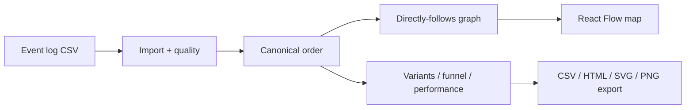

<a id="readme-top"></a>

<div align="center">

<picture>
  <source media="(prefers-color-scheme: dark)" srcset="docs/assets/banner-dark.svg">
  
</picture>

# Understand how hiring actually happens — from event logs to explainable insights.

**Process mining for hiring funnels.** Import an anonymized event log, explore the discovered map, bottlenecks, variants and conformance — with KPIs that always show numerator, sample size and method.

[Quick start](#quick-start) · [How it works](#how-it-works) · [Metric definitions](#metric-definitions) · [Testing](#testing)

</div>

## Problem

Hiring ops teams know their intended process, but the event log tells a different story: long waits between `Interview Scheduled` and `Interview Completed`, skipped stages, rework loops, and unfinished cases mixed into cycle-time charts. Generic KPI dashboards hide those paths. This app turns an anonymized CSV event log into a directly-follows map, variant ranking, funnel/drop-off, rework and rule-based conformance — without inventing causal root causes.

## Example input

| case_id | activity | timestamp | channel | job_family |
| --- | --- | --- | --- | --- |
| A | Applied | 2026-01-01T09:00:00Z | referral | engineering |
| A | Screened | 2026-01-02T10:00:00Z | referral | engineering |
| A | Interview Scheduled | 2026-01-03T11:00:00Z | referral | engineering |
| B | Applied | 2026-01-01T09:30:00Z | agency | design |
| B | Rejected | 2026-01-03T16:00:00Z | agency | design |

A fuller three-case CSV lives in [`samples/tiny-hiring-log.csv`](samples/tiny-hiring-log.csv). On first empty database start, the API seeds an 800-case synthetic log with a deterministic interview-scheduling bottleneck.

## Quick start

> [!NOTE]
> Native path verified on Windows 11 with `uv` + `pnpm` + SQLite. Docker Compose is provided for CI (`compose-smoke`); local Docker is not required. Core analytics are **pandas/NumPy**; PM4Py is an optional AGPL extra and is not required for the demo (see [`docs/DECISIONS.md`](docs/DECISIONS.md)).

```powershell
# Backend (API http://127.0.0.1:8102)
uv sync
uv run python -m hpm

# Frontend (http://127.0.0.1:5102) — new terminal
cd frontend
pnpm install
pnpm dev
```

With `SEED_ON_STARTUP=true` (Settings default), a synthetic 800-case hiring log is created when the DB is empty. Or use **Import → Generate synthetic** / upload `samples/tiny-hiring-log.csv`.

| Service | URL |
| --- | --- |
| Web | http://127.0.0.1:5102 |
| API docs | http://127.0.0.1:8102/docs |
| Health | http://127.0.0.1:8102/health |

Bind defaults to loopback. Non-loopback hosts require `ALLOW_NETWORK_BIND=true`. Compose maps `127.0.0.1:8102`, `127.0.0.1:5102`, `127.0.0.1:5402` (Postgres).

### API sketch

```powershell
# After seed or import
curl http://127.0.0.1:8102/api/datasets
curl "http://127.0.0.1:8102/api/datasets/<id>/process?min_case_ratio=0.05"
curl "http://127.0.0.1:8102/api/datasets/<id>/export/summary.csv" -o hiring-summary.csv
```

## How it works



1. Map CSV columns (`case_id`, `activity`, `timestamp`, optional attributes).
2. Validate timestamps (DST-safe UTC storage), duplicates and privacy notice.
3. Order every analytics path with `canonical_order()` (UTC time, then source row).
4. Discover DFG, variants, funnel, performance, rework and rule-based conformance in pandas.
5. Explore the map, filter, compare variants, edit the allowed-transition model, export.

## Dashboard tour

| Area | What you get |
| --- | --- |
| Overview | Case counts, completed-only cycle time, funnel reach, conformance fit, leading delay card |
| Import | Field mapper, preview, quality panel (ambiguous/nonexistent local times, duplicates) |
| Process map | React Flow DFG, edge-frequency slider, node/edge drawer, PNG/SVG/CSV/HTML export |
| Bottlenecks | Transparent insight cards + editable allowed-transition conformance |
| Variants | Top sequences and side-by-side compare |
| Cases | Filtered case list and event timeline |
| Methodology | Ordering, duplicate, delay, cycle-time and privacy contracts |

## Metric definitions

| Metric | Definition |
| --- | --- |
| Ordering | UTC timestamp ascending, then original source row number |
| Transition delay | Elapsed seconds between consecutive events after ordering — not labeled as processing time unless start/complete pairs exist |
| Cycle time | First→last event on **completed** cases only; ongoing cases are excluded from that distribution |
| Funnel | Distinct cases that reach each stage; denominator is documented in the API payload |
| Rework | Repeated activities within a case after ordering |
| Conformance | Rule-based fit against an editable allowed-transition model (no PM4Py required) |

Insight cards always expose **numerator**, **sample size** and **method**. Event logs alone do not prove causal root causes.

## Architecture

- **Backend:** FastAPI, SQLAlchemy 2 + Alembic, pandas/NumPy analytics, optional `pm4py` extra via lazy adapter
- **Frontend:** React + Vite + TypeScript + Tailwind, React Flow, Recharts, TanStack Query
- **Storage:** SQLite locally; PostgreSQL in Compose/CI (`5402` on the host)
- **Jobs:** Import/discovery work runs off the event loop; startup reaper fails stale `RUNNING` jobs

## Testing

```powershell
uv run ruff check src tests
uv run pytest -q
cd frontend
pnpm test
pnpm build
pnpm e2e   # Playwright: import → map → export (starts API 8102 + web 5102)
```

CI (GitHub Actions): backend Ruff + pytest against PostgreSQL; frontend lint/typecheck/Vitest/build; `compose-smoke` builds Compose and waits for `/ready` (Compose not verified on the Windows native path).

**Local verification (2026-10-20):** Ruff clean; pytest 30 passed / 2 skipped (optional PM4Py parity); Vitest 5 passed; `pnpm build` ok; Playwright e2e upload→map→export 1 passed.

## Security, privacy and limitations

> [!IMPORTANT]
> Designed for **anonymized** event logs. Do not upload candidate names, emails, resumes or demographics. Synthetic demo data is for exploration only. Not a hiring decision engine and not causal root-cause analysis.

- No auth in the MVP — loopback bind by default.
- Upload size and row caps are enforced server-side.
- PM4Py remains optional because of AGPL-3.0-or-later (`docs/DECISIONS.md`).

License: pending owner decision (AGPL implications may apply if you enable the PM4Py extra).

GitHub About text and topics: [`docs/GITHUB_METADATA.md`](docs/GITHUB_METADATA.md).

<p align="right"><a href="#readme-top">↑ back to top</a></p>
