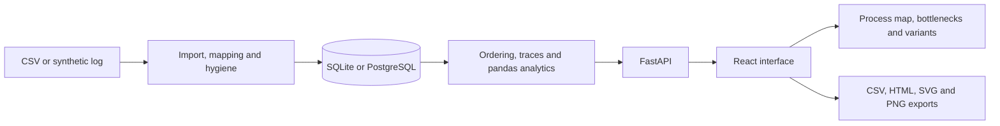

<p align="center"></p>

# Hiring Process Miner

**Turn anonymized hiring event logs into inspectable process maps, wait times, and variants.**

[](https://github.com/hasanhuseyinyetkiner/hiring-process-miner/actions/workflows/ci.yml)
[](LICENSE)

[Highlights](#highlights) · [Architecture](#architecture) · [Quick start](#quick-start) · [Evaluation](#engineering-and-evaluation) · [Documentation](#documentation)

<p align="center">
  <picture>
    <source media="(prefers-color-scheme: dark)" srcset="docs/screenshots/process-map-dark.png">
    
  </picture>
</p>

The process map above shows the seeded synthetic log. Select an activity to inspect case and event counts, filter a cohort, or export the view. See the [bottlenecks](docs/screenshots/bottlenecks-light.png) and [variants](docs/screenshots/variants-light.png) screens, or follow the [demo walkthrough](docs/DEMO.md).

[Watch the real import → process map → bottlenecks workflow (GIF)](docs/assets/demo.gif). The screenshot above is a static alternative; regenerate the animation on Windows with `node scripts/record_demo.mjs` after installing the project dependencies, Playwright Chromium and FFmpeg. The isolated synthetic data and recording are retained in a temporary folder.

> Local, single-user MVP. Recorded delays and drop-offs are observations, not causal findings or hiring decisions.

## Highlights

- **Discover the actual flow.** A directly-follows map, ranked variants, rework and funnel views expose skips and loops in recorded cases.
- **Measure waiting with context.** Transition latency includes mean, median, P90 and sample sizes; cycle-time metrics distinguish completed from ongoing cases.
- **Inspect data quality.** CSV mapping and a hygiene report surface excluded events and their reasons before they affect analytics.
- **Explore a cohort.** Status, channel, job family and outcome filters recalculate results; rule-based conformance compares traces with allowed transitions.
- **Take results with you.** Export summaries and reports as CSV or HTML, and the map as SVG or PNG.

## Architecture



The FastAPI service persists datasets with SQLAlchemy; SQLite is the local default and PostgreSQL is used by Compose and CI. Import work runs off the event loop. React Flow renders the process map, while pandas/NumPy implement the core analytics. An optional PM4Py adapter is separate from the default core. See [architecture](docs/ARCHITECTURE.md) and [engineering decisions](docs/ENGINEERING_DECISIONS.md).

## Engineering and evaluation

Event eligibility requires a case ID, an activity and an unambiguous timestamp; duplicates and invalid rows are reported rather than counted. Deterministic ordering makes ties reproducible, but cannot recover missing real-world ordering. Metric definitions and denominators are documented in [metrics](docs/METRICS.md).

The seed-42 demonstration contains **800 eligible synthetic cases**. Its leading *Interview Scheduled → Interview Completed* transition has a median of approximately **14.68 days**; that delay is intentionally constructed in the generator and is not evidence about an employer. Quality-probe rows are excluded from eligible analytics. [Reproduce the evaluation](docs/EVALUATION.md) and inspect the [metric definitions](docs/METRICS.md).

## Quick start

Requires Python 3.12+, [uv](https://docs.astral.sh/uv/), Node.js and pnpm. The native path was previously verified on Windows with SQLite. From the repository root, start the API:

```powershell
uv sync
uv run python -m hpm
```

In a second terminal, from the repository root:

```powershell
cd frontend
pnpm install
pnpm dev
```

Open [the app](http://127.0.0.1:5102) or [API documentation](http://127.0.0.1:8102/docs). An empty database seeds the synthetic log by default; alternatively import the [tiny sample](samples/tiny-hiring-log.csv) or generate a synthetic dataset in the UI. Configuration is in [`.env.example`](.env.example). CI defines a Compose smoke test; Compose is not required for this native path.

## Tests

From the repository root, then from `frontend`:

```powershell
uv run ruff check src tests
uv run pytest -q
cd frontend
pnpm lint
pnpm test
pnpm build
pnpm exec playwright install chromium  # once
pnpm e2e
```

CI defines link, backend, frontend, Playwright and Compose checks in [its workflow](.github/workflows/ci.yml). The previous local report dated 2026-10-21 recorded 31 backend tests passed and 2 optional PM4Py tests skipped; see [evaluation](docs/EVALUATION.md) for reproduction and limits. These are historical results, not a claim about the current run.

## Security and limitations

Use synthetic or anonymized event logs; remove names, email addresses, resumes and demographics before upload. The importer stores the uploaded CSV; it does not anonymize it, and pseudonymous case IDs may still be identifying. The MVP has no multi-user authentication and binds to loopback by default; non-loopback binding requires `ALLOW_NETWORK_BIND=true`. Server-side upload and row limits apply. XES import is not shipped. See [security](docs/SECURITY.md) and [limitations](docs/LIMITATIONS.md).

The repository is [MIT licensed](LICENSE). The optional `uv sync --extra pm4py` path installs PM4Py, an **AGPL-3.0-or-later** dependency; review its license before enabling it. It is not required for core discovery.

## Documentation

- [Demo walkthrough](docs/DEMO.md) and [sample event log](samples/tiny-hiring-log.csv)
- [Architecture](docs/ARCHITECTURE.md) and [engineering decisions](docs/ENGINEERING_DECISIONS.md)
- [Metrics](docs/METRICS.md) and [evaluation](docs/EVALUATION.md)
- [Security](docs/SECURITY.md), [limitations](docs/LIMITATIONS.md) and [frontend setup](frontend/README.md)
