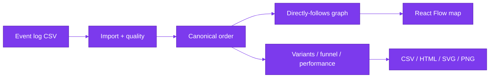

<a id="readme-top"></a>

<div align="center">

<picture>
  <source media="(prefers-color-scheme: dark)" srcset="docs/assets/banner-dark.svg">
  
</picture>

[](https://github.com/hasanhuseyinyetkiner/hiring-process-miner/actions/workflows/ci.yml)

**Understand how hiring actually happens — from event logs to explainable insights.**

Process mining for hiring funnels: import an anonymized event log, explore the discovered map, bottlenecks, variants and conformance — with KPIs that always show numerator, sample size and method.

[Quick start](#quick-start) · [60-second demo](#60-second-demo) · [How it works](#how-it-works) · [Testing](#testing)

</div>

<p align="center">
  <picture>
    <source media="(prefers-color-scheme: dark)" srcset="docs/screenshots/process-map-dark.png">
    
  </picture>
</p>

## Why it exists

Hiring ops teams know the intended process. The event log often tells a different story: long waits between `Interview Scheduled` and `Interview Completed`, skipped stages, rework loops, and unfinished cases mixed into cycle-time charts. Generic KPI dashboards hide those paths.

This app turns an anonymized CSV into a directly-follows map, variant ranking, funnel/drop-off, rework and rule-based conformance — without inventing causal root causes.

## Feature status

| Capability | Status | Notes |
| --- | --- | --- |
| CSV import + column mapper + quality panel | Shipped | Size/row caps; DST-aware timestamp policy |
| Synthetic seed (deterministic) | Shipped | 800 generated cases + quality probes → **802** eligible cases (seed 42) |
| Directly-follows process map (React Flow) | Shipped | Edge-frequency filter; node/edge drawer; PNG/SVG export |
| Variants + side-by-side compare | Shipped | Top sequences with case counts |
| Bottleneck insight cards | Shipped | Always expose numerator, sample size, method |
| Funnel / rework / performance | Shipped | Completed-only cycle time; ongoing cases excluded |
| Rule-based conformance | Shipped | Editable allowed-transition model; pandas core |
| Filters (status, channel, job family, outcome) | Shipped | Shared filter schema across analytics routes |
| CSV / HTML / SVG / PNG export | Shipped | Summary + HTML report with assumptions |
| Optional PM4Py token-replay / alignment | Optional extra | **AGPL-3.0-or-later** — not required for the demo ([`docs/DECISIONS.md`](docs/DECISIONS.md)) |
| XES import | Not shipped | Spec phase-2; CSV only in this MVP |
| Multi-user auth | Not shipped | Loopback demo only |

## Quick start

> [!NOTE]
> Native path verified on Windows 11 with `uv` + `pnpm` + SQLite. Docker Compose is exercised by CI (`compose-smoke`); local Docker is not required. Core analytics are **pandas/NumPy**. PM4Py is an optional AGPL extra and is **not** installed by default.

```powershell
# Backend (API http://127.0.0.1:8102)
uv sync
uv run python -m hpm

# Frontend (http://127.0.0.1:5102) — new terminal
cd frontend
pnpm install
pnpm dev
```

| Service | URL |
| --- | --- |
| Web | http://127.0.0.1:5102 |
| API docs | http://127.0.0.1:8102/docs |
| Health | http://127.0.0.1:8102/health |

With `SEED_ON_STARTUP=true` (Settings default), an empty database seeds the synthetic log (`generator_cases=800`, typical `case_count=802`). Or use **Import → Generate synthetic** / upload [`samples/tiny-hiring-log.csv`](samples/tiny-hiring-log.csv).

Env overrides: [`.env.example`](.env.example). Bind defaults to loopback; non-loopback hosts require `ALLOW_NETWORK_BIND=true`. Compose maps `127.0.0.1:8102`, `127.0.0.1:5102`, `127.0.0.1:5402` (Postgres).

## 60-second demo

1. Open http://127.0.0.1:5102 — dataset **Demo hiring funnel · 802 cases** (Synthetic badge).
2. **Process map** → click **Interview Scheduled** → drawer shows case/event counts.
3. **Bottlenecks** → leading card: *Interview Scheduled → Interview Completed* highest median transition delay (~14.7 d on the seeded log), with numerator and sample size.
4. **Variants** → top paths ranked by case volume; compare two sequences.
5. Export **CSV** or **HTML** from the map toolbar.

Tiny three-case CSV for a cold import:

| case_id | activity | timestamp | channel | job_family |
| --- | --- | --- | --- | --- |
| A | Applied | 2026-01-01T09:00:00Z | referral | engineering |
| A | Screened | 2026-01-02T10:00:00Z | referral | engineering |
| A | Interview Scheduled | 2026-01-03T11:00:00Z | referral | engineering |
| B | Applied | 2026-01-01T09:30:00Z | agency | design |
| B | Rejected | 2026-01-03T16:00:00Z | agency | design |

Full sample: [`samples/tiny-hiring-log.csv`](samples/tiny-hiring-log.csv).

<p align="center">
  <picture>
    <source media="(prefers-color-scheme: dark)" srcset="docs/screenshots/bottlenecks-dark.png">
    
  </picture>
</p>

### API sketch

```powershell
curl http://127.0.0.1:8102/api/datasets
curl "http://127.0.0.1:8102/api/datasets/<id>/process?min_case_ratio=0.05"
curl "http://127.0.0.1:8102/api/datasets/<id>/export/summary.csv" -o hiring-summary.csv
```

## How it works



1. Map CSV columns (`case_id`, `activity`, `timestamp`, optional attributes).
2. Validate timestamps (DST-safe UTC storage), duplicates and privacy notice.
3. Order every analytics path with `canonical_order()` (UTC time, then source row).
4. Discover DFG, variants, funnel, performance, rework and rule-based conformance in pandas.
5. Explore the map, filter, compare variants, edit the allowed-transition model, export.

## Metric definitions

| Metric | Definition |
| --- | --- |
| Ordering | UTC timestamp ascending, then original source row number |
| Transition delay | Elapsed seconds between consecutive events after ordering — not labeled as processing time unless start/complete pairs exist |
| Cycle time | First→last event on **completed** cases only; ongoing cases excluded from that distribution |
| Funnel | Distinct cases that reach each stage; denominator documented in the API payload |
| Rework | Repeated activities within a case after ordering |
| Conformance | Rule-based fit against an editable allowed-transition model (no PM4Py required) |

Insight cards always expose **numerator**, **sample size** and **method**. Event logs alone do not prove causal root causes.

## Architecture

- **Backend:** FastAPI, SQLAlchemy 2 + Alembic, pandas/NumPy analytics, optional `pm4py` extra via lazy adapter
- **Frontend:** React + Vite + TypeScript + Tailwind, React Flow, Recharts, TanStack Query
- **Storage:** SQLite locally; PostgreSQL in Compose/CI (host `5402`)
- **Jobs:** Import/discovery off the event loop; startup reaper fails stale `RUNNING` jobs

## Testing

```powershell
uv run ruff check src tests
uv run pytest -q
cd frontend
pnpm test
pnpm build
pnpm e2e   # Playwright: import → map → export (API 8102 + web 5102)
pnpm screenshots   # Writes docs/screenshots/*.png against a live stack
```

| Suite | Result (2026-10-20, re-run) |
| --- | --- |
| `uv run pytest -q` | **30 passed**, **2 skipped** (optional PM4Py parity) |
| `pnpm test` (Vitest) | **5 passed** |
| Playwright screenshots | **2 passed** (light + dark; process map, bottlenecks, variants) |

CI (GitHub Actions): backend Ruff + pytest against PostgreSQL; frontend lint/typecheck/Vitest/build; `compose-smoke` builds Compose and waits for `/ready`. Check the [Actions](https://github.com/hasanhuseyinyetkiner/hiring-process-miner/actions) tab for the latest run — the badge above tracks `ci.yml`.

## Security, privacy and limitations

> [!IMPORTANT]
> Designed for **anonymized** event logs. Do not upload candidate names, emails, resumes or demographics. Synthetic demo data is for exploration only. Not a hiring decision engine and not causal root-cause analysis.

- No auth in the MVP — loopback bind by default.
- Upload size and row caps are enforced server-side.
- **PM4Py** remains an optional dependency because it is licensed **AGPL-3.0-or-later**. Enabling `uv sync --extra pm4py` may impose AGPL obligations on that deployment path; core discovery and KPIs never require it ([`docs/DECISIONS.md`](docs/DECISIONS.md)).

License: pending owner decision (AGPL implications may apply if you enable the PM4Py extra).

GitHub About text and topics: [`docs/GITHUB_METADATA.md`](docs/GITHUB_METADATA.md).

<p align="right"><a href="#readme-top">↑ back to top</a></p>
