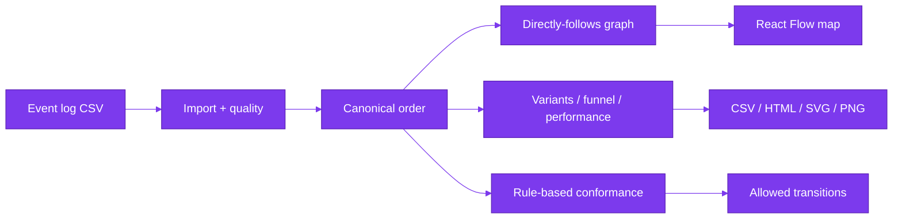

<a id="readme-top"></a>

<!-- A · Hero -->
<div align="center">

<picture>
  <source media="(prefers-color-scheme: dark)" srcset="docs/assets/banner-dark.svg">
  
</picture>

[](https://github.com/hasanhuseyinyetkiner/hiring-process-miner/actions/workflows/ci.yml)

**Understand how hiring actually happens — from event logs to explainable insights.**

Process mining for hiring funnels: import an anonymized event log, explore the discovered
map, bottlenecks, variants and conformance — with KPIs that always show numerator, sample
size and method.

[Overview](#executive-overview) · [Demo](#product-demonstration) · [Architecture](#system-architecture) · [Deep dive](#engineering-deep-dive) · [Evidence](#evaluation-and-evidence) · [Quick start](#getting-started) · [Docs](#documentation)

</div>

## Executive overview

| Dimension | Description |
| --- | --- |
| **Business challenge** | Hiring ops know the intended process; event logs show waits, skips, rework, and unfinished cases that KPI dashboards hide or over-interpret. |
| **Proposed solution** | Import an anonymized CSV → discover a directly-follows map, variants, bottlenecks, funnel/rework, and rule-based conformance with transparent numerators. |
| **Primary users** | Recruiting ops / people analytics reviewing funnel health; engineers evaluating process-mining product design. |
| **Engineering challenge** | Deterministic event ordering, completed-vs-ongoing cycle time, honest denominators, and optional PM4Py kept off the default path. |
| **Architecture** | FastAPI + pandas/NumPy · React + Vite + React Flow · SQLite local / PostgreSQL CI · accent `#7C3AED` |
| **Validation** | 30 pytest + 2 skipped (PM4Py absent); Vitest; Playwright import→map→export; golden hand-computed metrics |
| **Project status** | Local **MVP / demo**. Not a multi-user production SaaS. License pending. |

### Feature status

| Capability | Status | Notes |
| --- | --- | --- |
| CSV import + column mapper + quality panel | Shipped | Size/row caps; DST-aware timestamp policy |
| Synthetic seed (deterministic) | Shipped | `generator_cases=800`, seed 42 → **800** eligible cases (quality probes excluded) |
| Directly-follows process map (React Flow) | Shipped | Edge-frequency filter; node/edge drawer; PNG/SVG export |
| Variants + side-by-side compare | Shipped | Top sequences with case counts |
| Bottleneck insight cards | Shipped | Always expose numerator, sample size, method |
| Funnel / rework / performance | Shipped | Completed-only cycle time; ongoing cases excluded |
| Rule-based conformance | Shipped | Editable allowed-transition model; **pandas core** |
| Filters (status, channel, job family, outcome) | Shipped | Shared filter schema across analytics routes |
| CSV / HTML / SVG / PNG export | Shipped | Summary + HTML report with assumptions |
| Optional PM4Py token-replay / alignment | Optional extra | Dependency is **AGPL-3.0-or-later**; not required — review license before enabling ([`docs/ENGINEERING_DECISIONS.md`](docs/ENGINEERING_DECISIONS.md)) |
| XES import | Not shipped | Spec phase-2; CSV only in this MVP |
| Multi-user auth | Not shipped | Loopback demo only |

**Stack:** FastAPI + pandas/NumPy · React + Vite + TypeScript · SQLite locally /
PostgreSQL in Compose/CI · accent `#7C3AED`.

## Product demonstration

Verified on the seeded synthetic dataset (**Synthetic hiring log · 800 cases**, seed 42).
Screenshots captured from the live UI (ports **5102** / **8102**).

### Process map

Click a stage (e.g. **Interview Scheduled**) to open the drawer with case/event counts.

<p align="center">
  <picture>
    <source media="(prefers-color-scheme: dark)" srcset="docs/screenshots/process-map-dark.png">
    
  </picture>
</p>

### Bottlenecks

Leading card: *Interview Scheduled → Interview Completed* — highest median transition delay
among edges with ≥ 30 observations (~**14.7 d** UI display; exact API median ≈ 1 268 569 s on
seed 42; numerator **592** / sample size **504**). Banner states this is **not** a causal
root cause (observation ≠ causation).

<p align="center">
  <picture>
    <source media="(prefers-color-scheme: dark)" srcset="docs/screenshots/bottlenecks-dark.png">
    
  </picture>
</p>

### Variants

Top paths ranked by case volume (e.g. happy path ~159 cases / 19.8% on the seeded log);
compare two sequences side by side.

<p align="center">
  <picture>
    <source media="(prefers-color-scheme: dark)" srcset="docs/screenshots/variants-dark.png">
    
  </picture>
</p>

### 60-second walkthrough

1. Open http://127.0.0.1:5102 — dataset **Synthetic hiring log · 800 cases** (Synthetic badge).
2. **Process map** → click **Interview Scheduled** → drawer shows case/event counts.
3. **Bottlenecks** → inspect numerator / sample size / method on the leading card (~14.7 d).
4. **Variants** → rank paths; optionally compare two sequences.
5. Export **CSV** or **HTML** from the map toolbar.

Longer walkthrough: [`docs/DEMO.md`](docs/DEMO.md).

Tiny cold-import sample:

| case_id | activity | timestamp | channel | job_family |
| --- | --- | --- | --- | --- |
| A | Applied | 2026-01-01T09:00:00Z | referral | engineering |
| A | Screened | 2026-01-02T10:00:00Z | referral | engineering |
| A | Interview Scheduled | 2026-01-03T11:00:00Z | referral | engineering |
| B | Applied | 2026-01-01T09:30:00Z | agency | design |
| B | Rejected | 2026-01-03T16:00:00Z | agency | design |

Full file: [`samples/tiny-hiring-log.csv`](samples/tiny-hiring-log.csv).

```powershell
curl http://127.0.0.1:8102/api/datasets
curl "http://127.0.0.1:8102/api/datasets/<id>/process?min_case_ratio=0.05"
curl "http://127.0.0.1:8102/api/datasets/<id>/export/summary.csv" -o hiring-summary.csv
```

## Problem and engineering approach

**Problem.** Hiring dashboards often report averages that mix completed and ongoing cases,
treat wait time as “processing,” and present drop-offs as if they proved why candidates
left. Event logs support **observation**; they do not, by themselves, support **causation**.

**Approach.**

1. **Canonical ordering** — one sort contract for every metric (`utc_timestamp` then
   `source_row`).
2. **Transparent KPIs** — every insight card shows numerator, sample size and method.
3. **Completed ≠ ongoing** — cycle-time distributions never include unfinished cases.
4. **Explicit funnel denominators** — presence-based stage reach; drop-off is a set
   difference, not a story about intent.
5. **Rule-based conformance** — editable allowed transitions without requiring PM4Py.
6. **Causal caution** — UI copy refuses root-cause and hiring-recommendation language.

See [`docs/METRICS.md`](docs/METRICS.md), [`docs/EVALUATION.md`](docs/EVALUATION.md), and
[`docs/ENGINEERING_DECISIONS.md`](docs/ENGINEERING_DECISIONS.md).

## System architecture



| Layer | Role |
| --- | --- |
| **Backend** | FastAPI, SQLAlchemy 2 + Alembic, pandas/NumPy analytics, optional lazy `pm4py` adapter |
| **Frontend** | React + Vite + TypeScript + Tailwind, React Flow, Recharts, TanStack Query |
| **Storage** | SQLite locally; PostgreSQL in Compose/CI (host `5402`) |
| **Jobs** | Import/discovery off the event loop; startup reaper fails stale `RUNNING` jobs |

Full topology: [`docs/ARCHITECTURE.md`](docs/ARCHITECTURE.md).

## Engineering deep dive

| Topic | Contract |
| --- | --- |
| **Canonical ordering** | UTC timestamp ↑, then original `source_row` ↑ (`mergesort`). Every analytics path calls `canonical_order()` via `build_traces()`. |
| **Transition delay** | Elapsed seconds between consecutive events after ordering — **not** processing time (single timestamp per event). |
| **Completed vs ongoing cycle time** | Terminal activities: `Hired`, `Rejected`, `Withdrawn`. Cycle = first → earliest terminal. Ongoing cases excluded from that distribution; aging uses explicit `as_of`. |
| **Funnel denominators** | Denominator = distinct filtered `case_id`. Stage reach = activity **present** somewhere in the case. Drop-off = set difference vs previous happy-path stage. |
| **Conformance** | Case fits iff every consecutive pair is in the editable allowed-transition model. **Does not use PM4Py.** Token-replay/alignment only behind `uv sync --extra pm4py` (dependency AGPL-3.0-or-later — license review advised). |
| **Insight cards** | Always expose numerator, sample size, method + causal caution string. |

Details and seed-42 reproduction: [`docs/METRICS.md`](docs/METRICS.md) ·
[`docs/EVALUATION.md`](docs/EVALUATION.md).

## Evaluation and evidence

```powershell
uv run ruff check src tests
uv run pytest -q
cd frontend
pnpm test
pnpm build
pnpm e2e   # Playwright: import → map → export (API 8102 + web 5102)
pnpm screenshots   # Writes docs/screenshots/*.png against a live stack
```

| Suite | Result (verified 2026-10-20) |
| --- | --- |
| `uv run pytest -q` | **30 passed**, **2 skipped** (optional PM4Py DFG parity when `pm4py` absent) |
| `uv run ruff check src tests` | All checks passed |
| `pnpm test` (Vitest) | **5 passed** (3 files) |
| Playwright screenshots | Assets present: process map / bottlenecks / variants × light+dark |

Golden fixtures in `tests/test_metrics.py` hand-compute medians, p90, cycle time, funnel
denominator and conformance on a three-case log. Seed tests assert deterministic generation
and that interview wait is the longest median on the synthetic funnel.

CI (GitHub Actions): backend Ruff + pytest against PostgreSQL; frontend lint / typecheck /
Vitest / build; `compose-smoke` builds Compose and waits for `/ready`. Latest run:
[Actions](https://github.com/hasanhuseyinyetkiner/hiring-process-miner/actions).

## Engineering competencies demonstrated

| Competency | Evidence in this repo |
| --- | --- |
| Process-mining domain literacy | DFG, variants, funnel denominators, rework, conformance — with observation≠causation discipline |
| Correctness under messy time data | DST ambiguous/nonexistent fixtures; equal-timestamp tie-break; negative durations discarded |
| Licensing-aware architecture | pandas core; optional PM4Py (AGPL dependency) behind lazy adapter + skipped parity tests |
| API / product engineering | Typed FastAPI DTOs, shared filters, `/health`+`/ready`, job reaper, upload caps |
| Frontend systems | Interactive React Flow map, insight cards, methodology copy, light/dark, export |
| Test strategy | Hand-computed golden tests, API integration, Vitest, Playwright journey + screenshot capture |
| Staff communication | README + `docs/*` that a stranger can run and audit in minutes |

## Getting started

> [!NOTE]
> Native path verified on Windows 11 with `uv` + `pnpm` + SQLite. Docker Compose is
> exercised by CI (`compose-smoke`); local Docker is not required. Core analytics are
> **pandas/NumPy**. PM4Py is an optional extra (dependency AGPL-3.0-or-later) and is **not**
> installed by default.

```powershell
# Backend (API http://127.0.0.1:8102)
uv sync
uv run python -m hpm

# Frontend (http://127.0.0.1:5102) — new terminal
cd frontend
pnpm install
pnpm dev
```

| Service | URL |
| --- | --- |
| Web | http://127.0.0.1:5102 |
| API docs | http://127.0.0.1:8102/docs |
| Health | http://127.0.0.1:8102/health |

With `SEED_ON_STARTUP=true` (Settings default), an empty database seeds the synthetic log
(`generator_cases=800`, `case_count=800`, seed 42). Or use **Import → Generate synthetic** /
upload [`samples/tiny-hiring-log.csv`](samples/tiny-hiring-log.csv).

Env overrides: [`.env.example`](.env.example). Bind defaults to loopback; non-loopback hosts
require `ALLOW_NETWORK_BIND=true`. Compose maps `127.0.0.1:8102`, `127.0.0.1:5102`,
`127.0.0.1:5402` (Postgres).

Optional PM4Py path (dependency is AGPL-3.0-or-later — review with qualified counsel before
enabling in a deployment you care about; this README is not legal advice):

```powershell
uv sync --extra pm4py
```

## Security, privacy, and limitations

> [!IMPORTANT]
> Designed for **anonymized** event logs. Do not upload candidate names, emails, resumes or
> demographics. Synthetic demo data is for exploration only. Not a hiring decision engine
> and not causal root-cause analysis.

- No auth in the MVP — loopback bind by default.
- Upload size and row caps are enforced server-side.
- **PM4Py** remains an optional dependency licensed **AGPL-3.0-or-later**. Core discovery
  and KPIs never require it. Enabling `uv sync --extra pm4py` may have licensing
  implications for that deployment path — have counsel review before production use
  ([`docs/ENGINEERING_DECISIONS.md`](docs/ENGINEERING_DECISIONS.md)). This project does not
  assert categorical legal conclusions about your obligations.

Further detail: [`docs/SECURITY.md`](docs/SECURITY.md) · [`docs/LIMITATIONS.md`](docs/LIMITATIONS.md).

License: pending owner decision. No `LICENSE` file is shipped in this MVP.

## Documentation

| Doc | Contents |
| --- | --- |
| [`docs/DEMO.md`](docs/DEMO.md) | Analyst case study: logs → auditable observation |
| [`docs/ARCHITECTURE.md`](docs/ARCHITECTURE.md) | Runtime topology, layers, ports |
| [`docs/ENGINEERING_DECISIONS.md`](docs/ENGINEERING_DECISIONS.md) | Licensing posture, ordering, causation, jobs |
| [`docs/DECISIONS.md`](docs/DECISIONS.md) | Short HPM-1…3 summaries |
| [`docs/METRICS.md`](docs/METRICS.md) | Formal KPI definitions + seed-42 reproduction |
| [`docs/EVALUATION.md`](docs/EVALUATION.md) | Analytical evaluation summary |
| [`docs/SECURITY.md`](docs/SECURITY.md) | Privacy and demo threat model |
| [`docs/LIMITATIONS.md`](docs/LIMITATIONS.md) | Honest MVP boundaries |
| [`docs/GITHUB_METADATA.md`](docs/GITHUB_METADATA.md) | About text, topics, pin rationale (no OSS claim without license) |
| [`docs/RELEASE_READINESS.md`](docs/RELEASE_READINESS.md) | Pre-release checklist |
| [`docs/PRODUCT_SPEC.md`](docs/PRODUCT_SPEC.md) | **Historical** original brief (not current contract) |
| [`docs/REVIEW_AMENDMENTS.md`](docs/REVIEW_AMENDMENTS.md) | Binding design-review overrides |
| [`frontend/README.md`](frontend/README.md) | UI ports 5102/8102, React Flow, screenshots |

GitHub About text and topics: [`docs/GITHUB_METADATA.md`](docs/GITHUB_METADATA.md).

<p align="right"><a href="#readme-top">↑ back to top</a></p>
