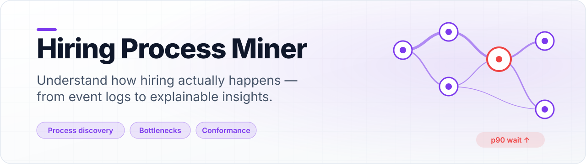
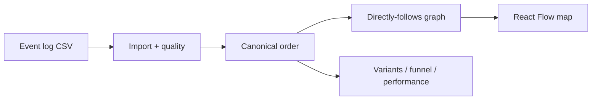

<a id="readme-top"></a>

<div align="center">

<picture>
  <source media="(prefers-color-scheme: dark)" srcset="docs/assets/banner-dark.svg">
  
</picture>

**Process mining for hiring funnels.** Import an anonymized event log, explore the discovered map, bottlenecks, variants and conformance — with KPIs that always show numerator, sample size and method.

[Quick start](#quick-start) · [How it works](#how-it-works) · [Limitations](#security-privacy-and-limitations)

</div>

## Quick start

> [!NOTE]
> Native path verified on Windows 11. Core analytics are **pandas/NumPy**; PM4Py is an optional AGPL extra and is not required for the demo.

```powershell
# Backend (API http://127.0.0.1:8102)
uv sync
uv run python -m hpm

# Frontend (http://127.0.0.1:5102) — new terminal
cd frontend
pnpm install
pnpm dev
```

With `seed_on_startup=true` (default), a synthetic 800-case hiring log is created when the DB is empty. Or use **Import → Generate synthetic** in the UI.

| Service | URL |
| --- | --- |
| Web | http://127.0.0.1:5102 |
| API docs | http://127.0.0.1:8102/docs |

## How it works



## Testing

```powershell
uv run pytest -q
cd frontend; pnpm test; pnpm build
```

## Security, privacy and limitations

> [!IMPORTANT]
> Synthetic demo data only. Not causal root-cause analysis. PM4Py remains optional because of AGPL-3.0.

License: pending owner decision (AGPL if you enable the PM4Py extra).

<p align="right"><a href="#readme-top">↑ back to top</a></p>
