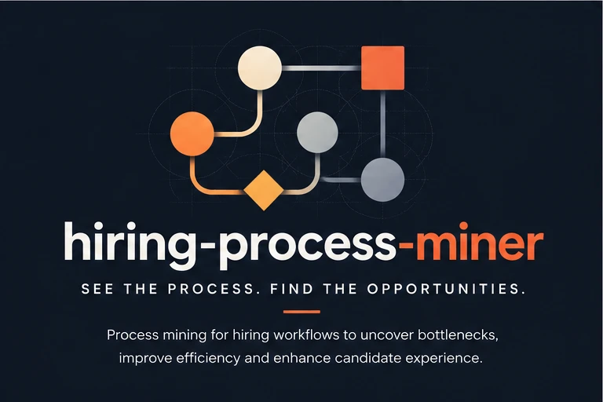
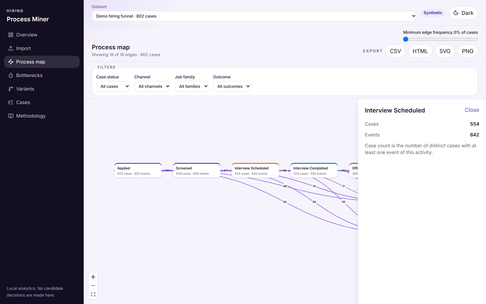
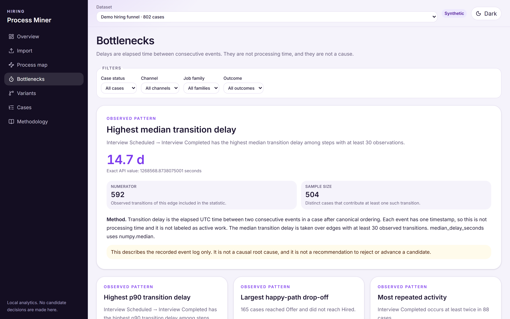
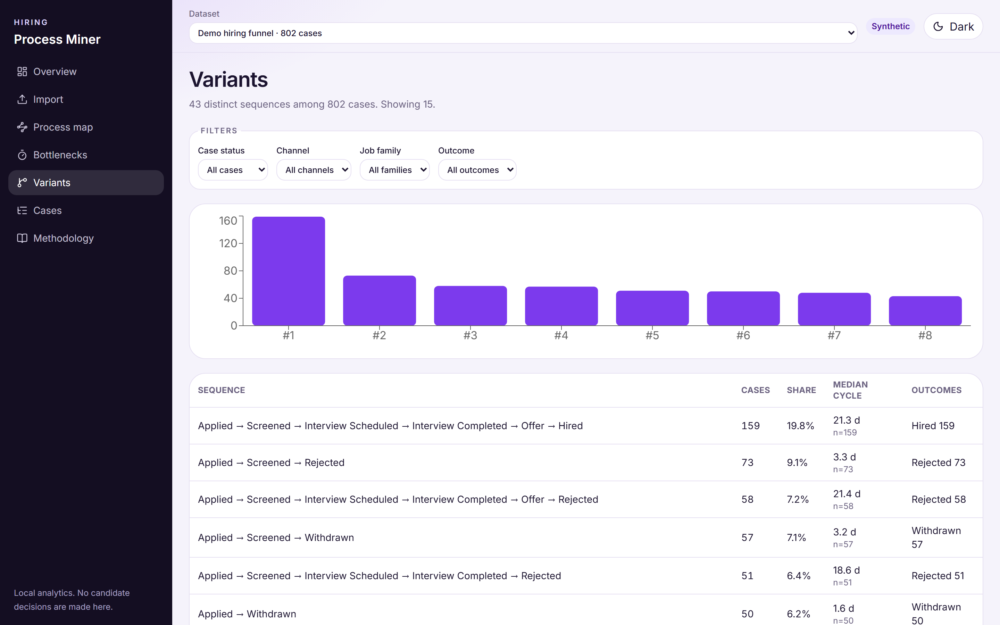
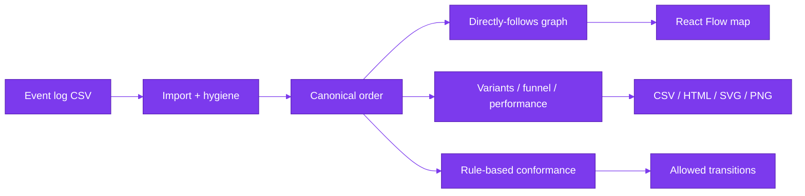

<a id="readme-top"></a>

<div align="center">

<p align="center">
  
</p>

[](https://github.com/hasanhuseyinyetkiner/hiring-process-miner/actions/workflows/ci.yml)
[](LICENSE)

**Hiring Process Miner** — process mining for anonymized hiring event logs.

Import a CSV, explore the discovered map, bottlenecks, variants, and rule-based
conformance. Every insight shows numerator, sample size, and method.

[Why](#why-it-exists) · [Demo](#demo) · [Architecture](#architecture) · [Quick start](#quick-start) · [Docs](#documentation)

</div>

## For HR and talent leaders

| Question | What this tool gives you |
| --- | --- |
| **Where do candidates wait?** | Stage-to-stage latency with mean, median and P90, always with sample size. |
| **Where does the funnel leak or loop?** | Skips, rework and unfinished cases are shown, not hidden. |
| **Can I trust the data?** | A hygiene inspector lists every excluded event and why. |
| **What it is not** | A bottleneck is an observation, not a cause. No hiring decisions. Anonymized or synthetic logs only. |

## Why it exists

Hiring ops know the intended funnel; event logs show waits, skips, rework, and unfinished
cases that KPI dashboards often hide or over-interpret. This app turns an anonymized log
into auditable observations — not causal root causes, and not hiring decisions.

**Users:** recruiting ops / people analytics reviewing funnel health; engineers evaluating
process-mining product design.

**Status:** local MVP / demo. Loopback bind by default. Not a multi-user production SaaS.

## Capabilities

| Capability | Status |
| --- | --- |
| CSV import, column mapper, data-hygiene / excluded-events inspector | Shipped |
| Synthetic seed (`generator_cases=800`, seed 42 → **800** eligible; QX probes excluded) | Shipped |
| Directly-follows process map (React Flow), edge filter, PNG/SVG export | Shipped |
| Variants + side-by-side compare | Shipped |
| Bottleneck cards + transition latency table | Shipped |
| Funnel / rework / performance (completed-only cycle time) | Shipped |
| Cohort filters (status, channel, job family, outcome) → API recalculation | Shipped |
| Rule-based conformance (pandas; editable allowed transitions) | Shipped |
| CSV / HTML / SVG / PNG export | Shipped |
| Optional PM4Py token-replay / alignment | Optional extra (dependency **AGPL-3.0-or-later**) |
| XES import, multi-user auth | Not shipped |

**Stack:** FastAPI + pandas/NumPy · React + Vite + TypeScript · SQLite locally /
PostgreSQL in Compose/CI · accent `#7C3AED`.

## Demo

Verified on the seeded synthetic dataset (**Synthetic hiring log · 800 cases**, seed 42).
Screenshots from the live UI (ports **5102** / **8102**).

### Process map

<p align="center">
  <picture>
    <source media="(prefers-color-scheme: dark)" srcset="docs/screenshots/process-map-dark.png">
    
  </picture>
</p>

### Bottlenecks

Leading card: *Interview Scheduled → Interview Completed* — highest median transition
delay among edges with ≥ 30 observations (~**14.68 d**; exact API median ≈ 1 268 569 s on
seed 42; numerator **592** / sample size **504**). Observation ≠ causation.

<p align="center">
  <picture>
    <source media="(prefers-color-scheme: dark)" srcset="docs/screenshots/bottlenecks-dark.png">
    
  </picture>
</p>

### Variants

Top paths ranked by case volume (happy path ~159 cases / 19.8% on the seeded log).

<p align="center">
  <picture>
    <source media="(prefers-color-scheme: dark)" srcset="docs/screenshots/variants-dark.png">
    
  </picture>
</p>

### 60-second walkthrough

1. Open http://127.0.0.1:5102 — dataset **Synthetic hiring log · 800 cases** (Synthetic badge).
2. **Process map** → click **Interview Scheduled** → drawer shows case/event counts.
3. **Bottlenecks** → inspect ~14.68 d leading card and the transition latency table.
4. **Overview** → open Data Hygiene to see QX probe rows excluded from analytics.
5. Change a cohort filter — KPIs recalculate from the API (not a static snapshot).
6. Export **CSV** or **HTML** from the map toolbar.

Longer walkthrough: [`docs/DEMO.md`](docs/DEMO.md).

Tiny sample: [`samples/tiny-hiring-log.csv`](samples/tiny-hiring-log.csv).

```powershell
curl http://127.0.0.1:8102/api/datasets
curl "http://127.0.0.1:8102/api/datasets/<id>/process?min_case_ratio=0.05"
curl "http://127.0.0.1:8102/api/datasets/<id>/export/summary.csv" -o hiring-summary.csv
```

## Architecture



| Layer | Role |
| --- | --- |
| Backend | FastAPI, SQLAlchemy 2 + Alembic, pandas/NumPy analytics, optional lazy `pm4py` adapter |
| Frontend | React + Vite + TypeScript + Tailwind, React Flow, Recharts, TanStack Query |
| Storage | SQLite locally; PostgreSQL in Compose/CI (host `5402`) |
| Jobs | Import off the event loop; startup reaper fails stale `RUNNING` jobs |

Contracts (ordering, completed vs ongoing, funnel denominators): [`docs/METRICS.md`](docs/METRICS.md) ·
[`docs/ENGINEERING_DECISIONS.md`](docs/ENGINEERING_DECISIONS.md). Topology:
[`docs/ARCHITECTURE.md`](docs/ARCHITECTURE.md).

## Quick start

> [!NOTE]
> Native path verified on Windows 11 with `uv` + `pnpm` + SQLite. Docker Compose is
> exercised by CI (`compose-smoke`); local Docker is not required. Core analytics are
> **pandas/NumPy**. Optional PM4Py (`uv sync --extra pm4py`) pulls an **AGPL-3.0-or-later**
> upstream package — not installed by default; review that license before enabling.

```powershell
# Backend (API http://127.0.0.1:8102)
uv sync
uv run python -m hpm

# Frontend (http://127.0.0.1:5102) — new terminal
cd frontend
pnpm install
pnpm dev
```

| Service | URL |
| --- | --- |
| Web | http://127.0.0.1:5102 |
| API docs | http://127.0.0.1:8102/docs |
| Health | http://127.0.0.1:8102/health |

With `SEED_ON_STARTUP=true` (default), an empty database seeds the synthetic log
(`generator_cases=800`, `case_count=800`, seed 42). Or **Import → Generate synthetic** /
upload [`samples/tiny-hiring-log.csv`](samples/tiny-hiring-log.csv).

Env: [`.env.example`](.env.example). Non-loopback hosts require `ALLOW_NETWORK_BIND=true`.
Compose maps `127.0.0.1:8102`, `127.0.0.1:5102`, `127.0.0.1:5402`.

## Evaluation

```powershell
uv run ruff check src tests
uv run pytest -q
cd frontend
pnpm test
pnpm build
pnpm e2e   # Playwright: import → map → export (API 8102 + web 5102)
```

| Suite | Result (verified 2026-10-21) |
| --- | --- |
| `uv run pytest -q` | **31 passed**, **2 skipped** (PM4Py DFG parity absent) |
| `uv run ruff check src tests` | All checks passed |
| `pnpm test` / `pnpm build` | **5 passed**; production build OK |
| Playwright `pnpm e2e` | **1 passed** (import → map → export) |
| Seed 42 bottleneck | Median **14.6825 d**; cases **800**; QX probes excluded |

Golden fixtures: `tests/test_metrics.py`. Seed reproduction: [`docs/EVALUATION.md`](docs/EVALUATION.md).

## Security and limitations

Designed for **anonymized** event logs. Do not upload candidate names, emails, resumes, or
demographics. Synthetic data is for exploration only.

- No auth in the MVP — loopback bind by default.
- Upload size and row caps enforced server-side.
- Optional **PM4Py** is AGPL-3.0-or-later; core discovery never requires it.

Details: [`docs/SECURITY.md`](docs/SECURITY.md) · [`docs/LIMITATIONS.md`](docs/LIMITATIONS.md).

## License

This repository is licensed under the [MIT License](LICENSE).

The optional `pm4py` extra depends on [pm4py](https://github.com/pm4py/pm4py-core), which is
licensed **AGPL-3.0-or-later**. Installing `uv sync --extra pm4py` may change your
obligations for that deployment path — review with qualified counsel. This README is not
legal advice. The default install path does not include pm4py.

## Documentation

| Doc | Contents |
| --- | --- |
| [`docs/ARCHITECTURE.md`](docs/ARCHITECTURE.md) | Runtime topology |
| [`docs/ENGINEERING_DECISIONS.md`](docs/ENGINEERING_DECISIONS.md) | Ordering, QX, PM4Py boundary |
| [`docs/METRICS.md`](docs/METRICS.md) | KPI definitions + seed-42 figures |
| [`docs/EVALUATION.md`](docs/EVALUATION.md) | Reproduction commands |
| [`docs/DEMO.md`](docs/DEMO.md) | Longer walkthrough |
| [`docs/SECURITY.md`](docs/SECURITY.md) | Loopback / AGPL notes |
| [`docs/LIMITATIONS.md`](docs/LIMITATIONS.md) | Honest constraints |
| [`frontend/README.md`](frontend/README.md) | UI ports and screenshots |

<p align="right"><a href="#readme-top">↑ back to top</a></p>
