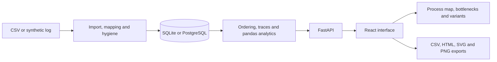

# Hiring Process Miner

A local application for exploring event logs as process maps, transition delays and case variants. It is designed for hiring workflows, with synthetic data for demonstration; it does not establish why a delay occurred or recommend hiring decisions.

<picture>
  <source media="(prefers-color-scheme: dark)" srcset="docs/screenshots/process-map-dark.png">
  
</picture>

The [demo walkthrough](docs/DEMO.md) and [recorded workflow](docs/assets/demo.gif) show import and analysis. The process map above uses 800 synthetic cases; [bottlenecks](docs/screenshots/bottlenecks-light.png) and [variants](docs/screenshots/variants-light.png) show other views.

## Architecture



The FastAPI service persists datasets with SQLAlchemy; SQLite is the local default and PostgreSQL is used by Compose and CI. Import work runs off the event loop. React Flow renders the process map, while pandas/NumPy implement the core analytics. An optional PM4Py adapter is separate from the default core. See [architecture](docs/ARCHITECTURE.md) and [engineering decisions](docs/ENGINEERING_DECISIONS.md).

## Engineering and evaluation

Event eligibility requires a case ID, an activity and an unambiguous timestamp; duplicates and invalid rows are reported rather than counted. Deterministic ordering makes ties reproducible, but cannot recover missing real-world ordering. Metric definitions and denominators are documented in [metrics](docs/METRICS.md).

The seed-42 demonstration contains **800 eligible synthetic cases**. The interview scheduling delay was planted by the generator, so its recovery is a sanity check, not evidence of real-world accuracy. In a separate 10-seed experiment, the app selected the planted transition in 10/10 runs at both zero and ±24 hours of independent timestamp jitter, but 0/10 at ±72 and ±168 hours. Timestamp noise can reorder activities and create different directly-following edges. The [experiment](docs/EVALUATION.md) specifies the setup, eligibility threshold, results and limits; [metrics](docs/METRICS.md) defines the measures.


## Quick start

Requires Python 3.12+, [uv](https://docs.astral.sh/uv/), Node.js and pnpm. The native path was previously verified on Windows with SQLite. From the repository root, start the API:

```powershell
uv sync
uv run python -m hpm
```

In a second terminal, from the repository root:

```powershell
cd frontend
pnpm install
pnpm dev
```

Open [the app](http://127.0.0.1:5102) or [API documentation](http://127.0.0.1:8102/docs). An empty database seeds the synthetic log by default; alternatively import the [tiny sample](samples/tiny-hiring-log.csv) or generate a synthetic dataset in the UI. Configuration is in [`.env.example`](.env.example). CI defines a Compose smoke test; Compose is not required for this native path.

## Tests

From the repository root, then from `frontend`:

```powershell
uv run ruff check src tests
uv run pytest -q
cd frontend
pnpm lint
pnpm test
pnpm build
pnpm exec playwright install chromium  # once
pnpm e2e
```

The [CI workflow](.github/workflows/ci.yml) runs link, backend, frontend, Playwright and Compose checks. The [evaluation](docs/EVALUATION.md) describes the experiments and their limits.

## Security and limitations

Use synthetic or anonymized event logs; remove names, email addresses, resumes and demographics before upload. The importer stores the uploaded CSV; it does not anonymize it, and pseudonymous case IDs may still be identifying. The MVP has no multi-user authentication and binds to loopback by default; non-loopback binding requires `ALLOW_NETWORK_BIND=true`. Server-side upload and row limits apply. XES import is not shipped. See [security](docs/SECURITY.md) and [limitations](docs/LIMITATIONS.md).

The repository is [MIT licensed](LICENSE). The optional `uv sync --extra pm4py` path installs PM4Py, an **AGPL-3.0-or-later** dependency; review its license before enabling it. It is not required for core discovery.

## Documentation

- [Demo walkthrough](docs/DEMO.md) and [sample event log](samples/tiny-hiring-log.csv)
- [Architecture](docs/ARCHITECTURE.md) and [engineering decisions](docs/ENGINEERING_DECISIONS.md)
- [Metrics](docs/METRICS.md) and [evaluation](docs/EVALUATION.md)
- [Security](docs/SECURITY.md), [limitations](docs/LIMITATIONS.md) and [frontend setup](frontend/README.md)
- [Changelog](CHANGELOG.md)
