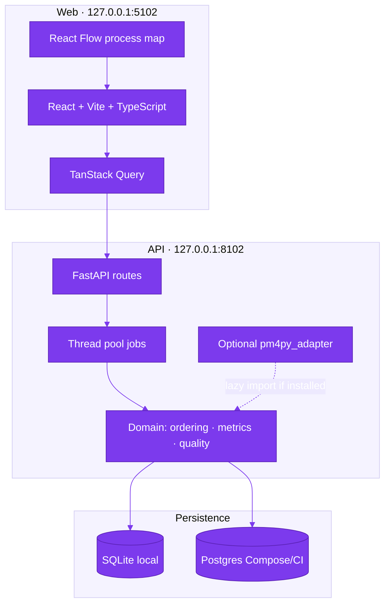
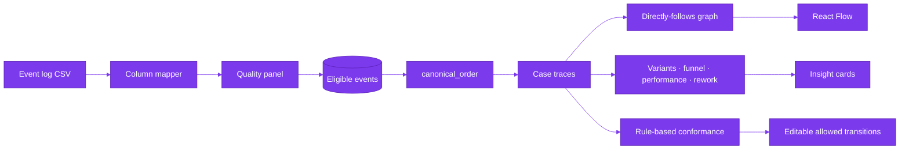

# Architecture

Hiring Process Miner is a single-user local demo: React + Vite on port **5102**, FastAPI
on port **8102**, SQLite by default (PostgreSQL via Compose/CI on host **5402**).

## Runtime topology

## Layering

| Layer | Location | Responsibility |
| --- | --- | --- |
| HTTP | `src/hpm/api/routes.py` | DTOs, filters, thread-pool handoff, exports |
| Services | `src/hpm/services/` | Import pipeline, query assembly, HTML report |
| Domain | `src/hpm/domain/` | Ordering, traces, DFG, funnel, variants, conformance, seed |
| Adapter | `src/hpm/pm4py_adapter.py` | Optional PM4Py path (AGPL dependency); not on the default import graph |
| UI | `frontend/src/` | Routes, map, insight cards, methodology copy |

Domain algorithms do not import FastAPI or React. Tests call domain functions with
hand-built frames (`tests/helpers.py`) so KPI expectations are independent of the API.

## Data flow (CSV → insight)

1. Upload or synthetic seed → draft → mapped columns → validated events.
2. Timestamps converted to UTC; ambiguous/nonexistent local times flagged and excluded
   from duration metrics under the default policy.
3. Every analytics call builds traces only after `canonical_order()`.
4. UI filters (`status`, `channel`, `job_family`, `outcome`) share one `FilterSpec`.
5. Exports (CSV summary, HTML report, SVG/PNG map) include assumptions from
   `hpm.domain.constants`.

## Technology rationale

| Choice | Why |
| --- | --- |
| pandas/NumPy core | Deterministic, testable KPIs without importing `pm4py` on the default path |
| Optional PM4Py | Token-replay/alignment behind lazy adapter; dependency is AGPL-3.0-or-later — license review advised |
| FastAPI + Pydantic v2 | Typed request/response contracts; OpenAPI at `/docs` |
| SQLAlchemy 2 + Alembic | Same models for SQLite and Postgres |
| React Flow | Interactive DFG with node/edge drawers and client-side export |
| Loopback bind | No auth in MVP; reduce accidental LAN exposure |

## Health and jobs

- `GET /health` — process up.
- `GET /ready` — migrations applied / DB reachable (Compose smoke waits on this).
- Import and discovery jobs store `status` and `heartbeat_at`; startup reaper fails
  stale `RUNNING` rows.

## Ports

| Service | Port |
| --- | --- |
| Web | 5102 |
| API | 8102 |
| Postgres (Compose host) | 5402 |

## See also

- [`ENGINEERING_DECISIONS.md`](ENGINEERING_DECISIONS.md) — licensing and correctness contracts
- [`METRICS.md`](METRICS.md) — formal definitions and seed-42 reproduction
- [`EVALUATION.md`](EVALUATION.md) — analytical evaluation summary
- [`DEMO.md`](DEMO.md) — analyst case study with screenshots
- [`RELEASE_READINESS.md`](RELEASE_READINESS.md) — pre-release checklist
- [`GITHUB_METADATA.md`](GITHUB_METADATA.md) — About box and topics
